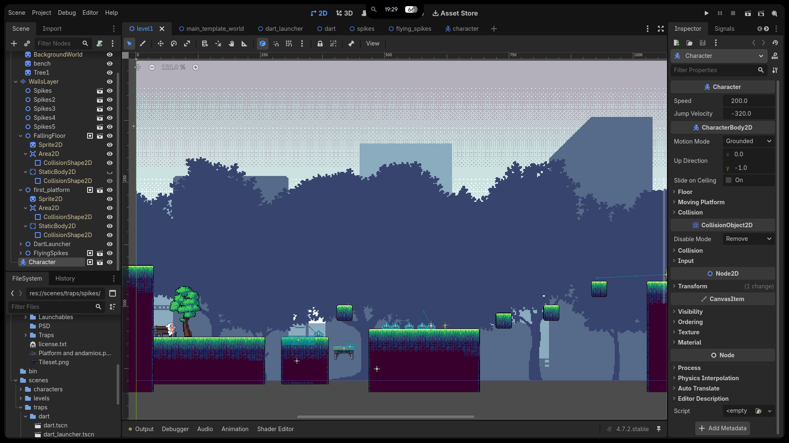

# Proyecto de Programacion Orientada a Objetos (POO)

Desarollo de videojuego de plataformas y trampas.
*Está en desarollo*, aunque la primera version beta v0.1 está disponible para probar el primer nivel prelimiar.

#### Teclas
`Space` Para saltar, uso de flechas `right` y `left` para el moviento repectivamente.
